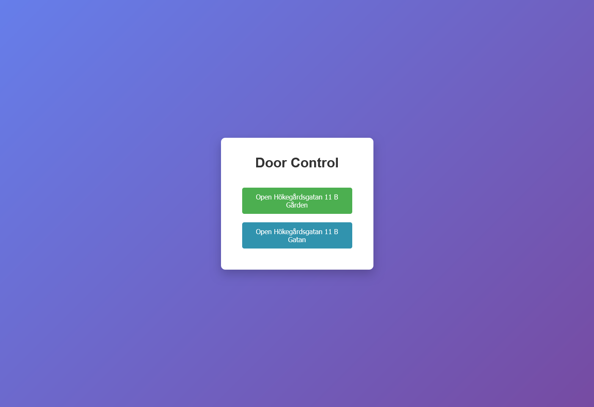
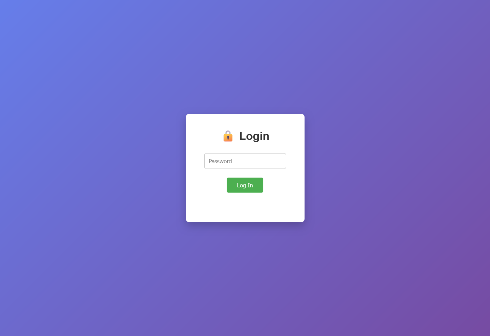

# 🔓 Door Controller

[![Last commit][last-commit-shield]][last-commit-url]
[![Repository size][repo-size-shield]][repo-size-url]
[![GitHub issues][issues-shield]][issues-url]

![React][tech-react-shield]
![Vite][tech-vite-shield]
![TypeScript][tech-ts-shield]
![Node.js][tech-node-shield]
![Docker][tech-docker-shield]

> A self-hosted door-control dashboard for triggering remote unlocks through a
> property management portal.



## Contents

1. [Features](#features)
2. [Screenshots](#screenshots)
3. [How it works](#how-it-works)
4. [Built with](#built-with)
5. [Configuration](#environment-variables)
6. [Local development](#local-development)
7. [Docker deployment](#docker-deployment)
8. [Authentication and security](#authentication)
9. [API reference](#api-reference)
10. [Contributing](#contributing)

## Features

- 🔐 Password-protected React interface with signed sessions.
- 🚪 Dynamic door buttons configured through one environment variable.
- ⚡ Per-door loading and result states without blocking unrelated controls.
- 🔔 Toast notifications for unlock progress, success, and failure.
- 🏠 Requests leave through the home server's network connection.
- 📦 One multi-stage Docker image containing both frontend and backend.
- 🔒 No portal credentials are stored by the application.

## Screenshots

| Login | Door control |
|---|---|
|  |  |

## How it works

```text
Browser
   |
   v
Express server on the home server
   |
   v
Property portal unlock endpoint
```

The browser calls the same-origin Express API. Express sends the unlock request
to the configured portal endpoint, so the portal sees the home server's
outbound IP address.

## Built with

![React][tech-react-shield]
![Vite][tech-vite-shield]
![TypeScript][tech-ts-shield]
![Express][tech-express-shield]
![Node.js][tech-node-shield]
![Docker][tech-docker-shield]

## Project structure

```text
doorcontrol/
├── Dockerfile
├── docker-compose.yml
├── package.json
├── client/
│   ├── package.json
│   ├── index.html
│   ├── vite.config.ts
│   └── src/
│       ├── App.tsx
│       ├── main.tsx
│       ├── auth/
│       ├── hooks/
│       └── pages/
└── server/
    ├── package.json
    └── server.js
```

## Environment variables

| Variable | Required | Example | Description |
|---|---|---|---|
| `UNLOCK_URL` | Yes | `https://hemma.sgs.se/DoorControl/PerformUnlock` | The exact endpoint used to unlock a door. |
| `DOORS` | Yes | `Front Gate,Back Entrance,Garage` | Comma-separated door names. Each value must exactly match the portal's expected `epName`, including accents, spaces, and punctuation. |
| `APP_PASSWORD` | Yes | `a-strong-shared-password` | Shared password required to access the application. |
| `SESSION_SECRET` | Yes | Output of `openssl rand -hex 32` | Secret used to sign session cookies. |
| `NODE_ENV` | Recommended | `development` or `production` | Controls the session cookie security mode. Use `development` for local HTTP and `production` behind HTTPS. |
| `PORT` | No | `8080` | Express listening port. The Docker image sets this to `80`. |

Example local `.env`:

```env
UNLOCK_URL=https://hemma.sgs.se/DoorControl/PerformUnlock
DOORS=Pilfinksgatan 11 B Gården,Pilfinksgatan 11 B Gatan
APP_PASSWORD=change-this-password
SESSION_SECRET=generate-a-long-random-string
NODE_ENV=development
```

The `.env` file contains secrets and must not be committed.

### Finding the correct door names

The values in `DOORS` are sent to the portal as the `epName` form field. To
find the correct values:

1. Open the portal's door-control page.
2. Open browser Developer Tools and select **Network**.
3. Trigger a door from the portal.
4. Find the POST request to the unlock endpoint.
5. Copy the exact `epName` value from the request body.
6. Preserve accents, spaces, punctuation, and capitalization.
7. Put the values in `DOORS`, separated by commas.

## Local development

Install all dependencies:

```powershell
npm run setup
```

Start the frontend and backend together:

```powershell
npm run dev
```

The development services use:

```text
React/Vite: http://localhost:3000
Express API: http://localhost:8080
```

Open the frontend at `http://localhost:3000`. Vite proxies development API
requests to the backend. Use `NODE_ENV=development` when running over plain
HTTP so the session cookie is not marked `Secure`.

Useful frontend commands:

```powershell
cd client
npm run build
npm test
npm run lint
```

The Express server can also be started separately:

```powershell
cd server
npm run dev
```

## Docker deployment

The root [Dockerfile](Dockerfile) uses a multi-stage build:

1. Installs frontend dependencies and builds `client/dist`.
2. Installs production backend dependencies.
3. Copies the React build into the backend image.
4. Starts Express, which serves both the API and React application.

The final container listens on port `80`.

### Local Docker testing

For local HTTP testing, use `NODE_ENV=development`:

```yaml
services:
  door-app:
    container_name: door_app
    build:
      context: .
      dockerfile: Dockerfile
    ports:
      - "80:80"
    environment:
      UNLOCK_URL: ${UNLOCK_URL}
      DOORS: ${DOORS}
      APP_PASSWORD: ${APP_PASSWORD}
      SESSION_SECRET: ${SESSION_SECRET}
      NODE_ENV: development
    restart: unless-stopped
```

Start it with:

```powershell
docker compose up -d --build
```

Open `http://localhost`. The port mapping format is:

```text
host port:container port
80:80
```

If port 80 is already in use, use another host port, for example:

```yaml
ports:
  - "8080:80"
```

Then open `http://localhost:8080`. The container port remains `80`.

View logs with:

```powershell
docker compose logs -f door-app
```

### Production with Traefik

For production, terminate HTTPS at Traefik and route traffic to container port
80:

```yaml
services:
  door-app:
    image: ghcr.io/<your-github-username>/door-app:latest
    container_name: door_app
    environment:
      UNLOCK_URL: ${UNLOCK_URL}
      DOORS: ${DOORS}
      APP_PASSWORD: ${APP_PASSWORD}
      SESSION_SECRET: ${SESSION_SECRET}
      NODE_ENV: production
    labels:
      - "traefik.enable=true"
      - "traefik.docker.network=web"
      - "traefik.http.routers.doorapp.rule=Host(`door.example.com`)"
      - "traefik.http.routers.doorapp.entrypoints=websecure"
      - "traefik.http.routers.doorapp.tls=true"
      - "traefik.http.services.doorapp.loadbalancer.server.port=80"
    networks:
      - web
    restart: unless-stopped

networks:
  web:
    external: true
```

The important production port is the Traefik service port:

```yaml
- "traefik.http.services.doorapp.loadbalancer.server.port=80"
```

Set `NODE_ENV=production` only when users access the application over HTTPS.
Production session cookies are marked `Secure` and will not work over plain
HTTP.

## Authentication

The frontend checks the current session at `/auth/check`. Logged-out users are
sent to `/login`. A successful login creates a signed, `httpOnly` session
cookie that lasts for seven days.

The browser automatically sends the same-origin session cookie with the API
requests. No password is stored in local storage, and the password is not
retained by the frontend after login.

## API reference

| Route | Method | Description |
|---|---|---|
| `/login` | POST | Accepts `{ "password": "..." }` and creates a session on success. |
| `/logout` | POST | Destroys the current session. |
| `/auth/check` | GET | Returns `200` when authenticated and `401` otherwise. |
| `/doors` | GET | Returns the configured doors as `[{ "id": "1", "name": "Front Gate" }]`. Requires authentication. |
| `/trigger/:doorId` | POST | Sends an unlock request for the selected door. Requires authentication. |

The unlock response contains:

```json
{
  "ok": true,
  "status": 302,
  "location": "https://portal.example.com/..."
}
```

The portal may return HTTP `302` for both success and failure. The server
checks the redirected location for `IsError=False`; an `IsError=True` response
means the portal rejected the unlock request. Verify the exact `DOORS` value
against the portal request when that happens.

## Security notes

- Use a strong, unique `APP_PASSWORD`.
- Generate a long random `SESSION_SECRET`.
- Do not commit `.env` or put secrets in the Docker image.
- Use HTTPS in production.
- The application has one shared password and no per-user accounts.
- Anyone with the password can trigger every door in `DOORS`.
- The login endpoint currently has no rate limiting or lockout. Consider
  adding rate limiting, IP allowlisting, or an additional access layer such
  as Cloudflare Access.
- The portal request relies on the portal's own access rules; this app does
  not store portal credentials.

## CI/CD

A GitHub Actions workflow can build and publish a multi-architecture image to
GitHub Container Registry:

```yaml
name: Build and Publish Docker Image

on:
  push:
    branches: [main]
  workflow_dispatch:

env:
  REGISTRY: ghcr.io
  IMAGE_NAME: ${{ github.repository }}

jobs:
  build-and-push:
    runs-on: ubuntu-latest
    permissions:
      contents: read
      packages: write
    steps:
      - uses: actions/checkout@v4
      - uses: docker/setup-qemu-action@v3
      - uses: docker/setup-buildx-action@v3
      - uses: docker/login-action@v3
        with:
          registry: ${{ env.REGISTRY }}
          username: ${{ github.actor }}
          password: ${{ secrets.GITHUB_TOKEN }}
      - uses: docker/build-push-action@v6
        with:
          context: .
          platforms: linux/amd64,linux/arm64
          push: true
          tags: |
            ${{ env.REGISTRY }}/${{ env.IMAGE_NAME }}:latest
            ${{ env.REGISTRY }}/${{ env.IMAGE_NAME }}:${{ github.sha }}
```

## Known limitations

- The portal must accept the request from the home server's network.
- Door names must match the portal's expected values exactly.
- A single shared password protects all configured doors.
- Door buttons alternate between the `btn-open` and `btn-close` styles.
- The portal may impose request-rate or concurrent-request limits.

## Contributing

1. Fork the repository.
2. Create a branch:

   ```sh
   git checkout -b feature/my-change
   ```

3. Install dependencies with `npm run setup`.
4. Make and test your changes.
5. Open a pull request with a short description of the change.

When changing the frontend, verify the production build with:

```powershell
cd client
npm run build
```

## Author

- [Erik Persson](https://github.com/erikpersson0884) 🐦 - Original author and maintainer

<!-- Repository badges -->
[last-commit-shield]: https://img.shields.io/github/last-commit/erikpersson0884/door-proxy/main?style=for-the-badge&cacheSeconds=30
[last-commit-url]: https://github.com/erikpersson0884/door-proxy/commits/main

[repo-size-shield]: https://img.shields.io/github/repo-size/erikpersson0884/door-proxy?style=for-the-badge&cacheSeconds=60
[repo-size-url]: https://github.com/erikpersson0884/door-proxy

[issues-shield]: https://img.shields.io/github/issues/erikpersson0884/door-proxy?style=for-the-badge
[issues-url]: https://github.com/erikpersson0884/door-proxy/issues

<!-- Technology badges -->
[tech-react-shield]: https://img.shields.io/badge/React-61DAFB?logo=react&logoColor=black&style=for-the-badge
[tech-vite-shield]: https://img.shields.io/badge/Vite-646CFF?logo=vite&logoColor=white&style=for-the-badge
[tech-ts-shield]: https://img.shields.io/badge/TypeScript-3178C6?logo=typescript&logoColor=white&style=for-the-badge
[tech-express-shield]: https://img.shields.io/badge/Express-000000?logo=express&logoColor=white&style=for-the-badge
[tech-node-shield]: https://img.shields.io/badge/Node.js-339933?logo=node.js&logoColor=white&style=for-the-badge
[tech-docker-shield]: https://img.shields.io/badge/Docker-2496ED?logo=docker&logoColor=white&style=for-the-badge
